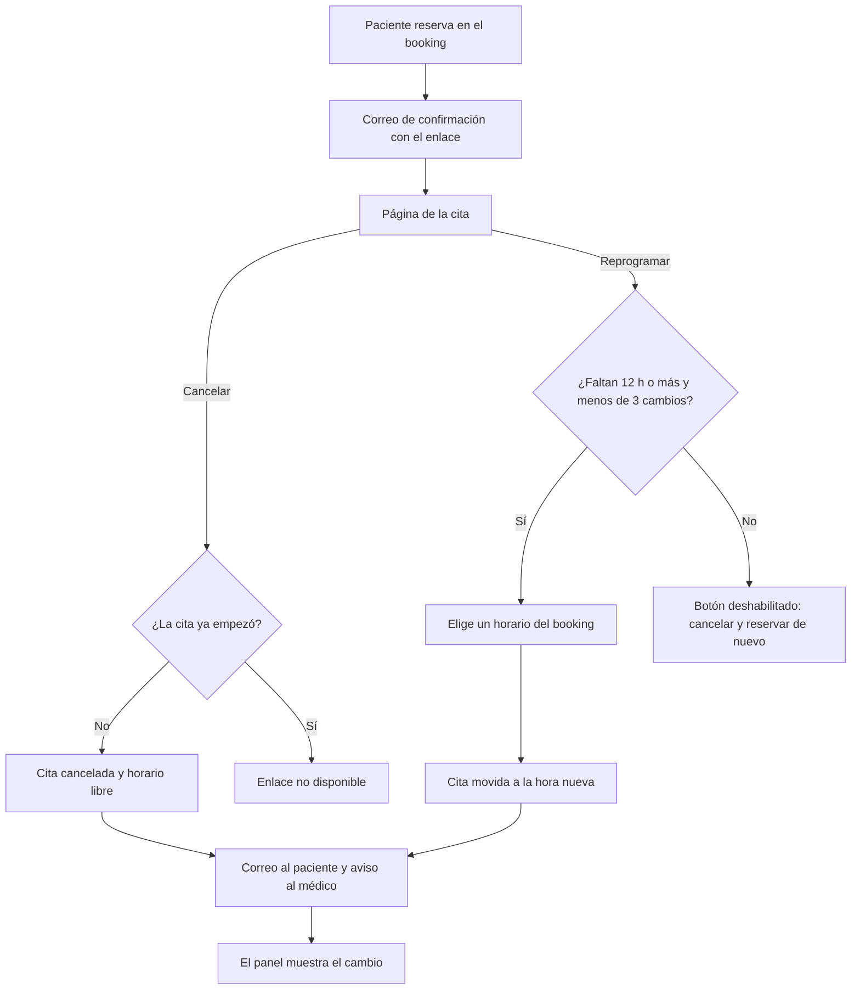

# Autogestión de la cita por el paciente

Última revisión: 11 de octubre de 2026, contra el código de la rama
`feat/autogestion-docs`. Es un documento vivo: si algo de aquí no coincide con
el código, **manda el código** y este documento se corrige.

Estrategia general: [`PRODUCT.md`](PRODUCT.md). Plan de implementación y
criterios de aceptación: [`features/autogestion-paciente/plan.md`](features/autogestion-paciente/plan.md).

## 1. Qué es y para qué se hizo

En Perú las citas se coordinan por teléfono y WhatsApp personal. Cuando un
paciente no puede ir, llama o escribe al médico, y el médico (o su asistente)
busca otro horario, mueve la cita a mano y libera el hueco. Si el paciente no
avisa, el hueco se pierde.

La tesis de WizyDoc es que **el médico no coordina nada**. La autogestión es
la primera pieza de esa tesis: el paciente recibe un enlace en el correo de
confirmación y desde ahí ve su cita, la cancela o la reprograma, sin cuenta y
sin hablar con nadie.

Qué entrega:

- Al paciente: cambiar su cita en menos de un minuto desde el celular, a
  cualquier hora.
- Al médico: no recibe esas llamadas, el hueco cancelado vuelve a estar libre
  para otro paciente y su agenda refleja el cambio sin que haga nada.

## 2. A quién está dirigido

- **Paciente.** No tiene cuenta. Llega desde el correo, casi siempre en el
  celular. La página es mobile-first.
- **Médico.** Beneficiario indirecto: no usa la autogestión, pero recibe un
  aviso por correo cuando un paciente cancela o reprograma y ve el cambio en su
  agenda.

Quién **no** la usa:

- El personal del consultorio: el panel no tiene botones para cancelar ni
  mover citas (ver sección 3).
- Quien reservó con un documento que ya tenía ficha con otro correo: el enlace
  va al correo de la ficha, no al que escribió (ver secciones 7 y 9).
- Los pacientes con citas creadas antes del lanzamiento: esas citas no tienen
  enlace.

## 3. Qué puede hacer el paciente y qué no

| Acción | Regla |
| --- | --- |
| Ver su cita | Mientras la cita no haya empezado. |
| Cancelar | Siempre, hasta que empiece la cita, sin importar cuánto falte. No hay "cancelación tardía": cancelar a dos días o a cinco minutos da el mismo resultado. |
| Reprogramar | Hasta 12 horas antes de la hora **actual** de la cita y como máximo 3 veces por cita. Mismo médico, misma sede y misma especialidad, entre los horarios que ofrece el booking. |

Detalles de la reprogramación:

- El plazo de 12 horas se mide sobre la hora que tiene la cita, no sobre la
  nueva: se puede mover una cita del lunes a una hora de hoy mismo, si hay
  hueco.
- Pasado el plazo o el tope, el botón "Reprogramar" aparece deshabilitado con
  el motivo escrito debajo y la salida: cancelar y reservar otro horario.
  "Cancelar cita" sigue activo.
- Para cambiar de médico, de sede o de especialidad, el paciente cancela y
  reserva de nuevo. Tras cancelar, la página ofrece "Reservar otro horario",
  que lleva al booking de la misma sede.

Cuando la cita empieza, el enlace deja de funcionar: muestra "Este enlace ya no
está disponible".

**Fuera de alcance por ahora:**

- Confirmar la asistencia (el estado "confirmada" existe en el modelo pero
  nadie lo asigna).
- Recordatorios antes de la cita.
- Cancelar o mover citas desde el panel del consultorio.
- WhatsApp: el enlace sólo viaja por correo.

## 4. Cómo funciona de punta a punta

1. El paciente reserva en el booking público. Al crear la cita se genera su
   enlace de autogestión.
2. Recibe el correo de confirmación con el botón "Cancelar o reprogramar".
   El enlace **no** aparece en la pantalla de "Cita reservada" ni en la
   respuesta del servidor: sólo en el correo de la ficha.
3. Abre la página `/appointment/manage/<token>`: saludo con su nombre de pila,
   estado, especialidad, médico, fecha y hora (de Lima), duración, sede y
   dirección, y los dos botones.
4. **Cancelar:** pantalla de confirmación ("¿Cancelar tu cita?") y, al aceptar,
   "Tu cita está cancelada". El horario queda libre.
5. **Reprogramar:** elige día y hora con el mismo selector del booking, ve el
   "Antes" y el "Ahora", confirma y ve "Listo, tu cita cambió". El mismo enlace
   sigue sirviendo para la cita nueva.
6. Se envían los correos: uno al paciente (cancelada o reprogramada) y un aviso
   al médico de la cita.
7. En el panel, la agenda del día y la ficha del paciente muestran la cita
   cancelada como "Cancelada", o la cita reprogramada en su hora nueva.

Casos que la página resuelve sin ayuda:

- **Otro paciente tomó el horario elegido** mientras el paciente confirmaba:
  vuelve al selector con "Otro paciente acaba de tomar ese horario. Elige
  otro." y los horarios recargados.
- **La cita cambió desde otra pestaña o dispositivo:** pantalla "Tu cita
  cambió mientras elegías" con "Recargar".
- **Doble toque al cancelar:** el segundo no es un error ni envía correos.

## 5. Estados de la cita y lo que cambia

Hoy una cita creada desde el booking queda en **pendiente**. La autogestión
sólo añade un cambio de estado: a **cancelada**.

- **Cancelar** pasa la cita a cancelada y guarda cuándo se canceló. Es
  definitivo: no se puede reprogramar una cita cancelada. Una cita cancelada
  **no ocupa el horario**: otro paciente puede reservarlo desde el booking.
- **Reprogramar** no crea una cita nueva ni cancela la anterior: **mueve la
  misma cita** a la hora nueva y suma uno al contador de reprogramaciones. Por
  eso en la agenda y en la ficha aparece una sola cita, en su hora nueva, y lo
  que ya estuviera ligado a esa cita sigue ligado a ella.

Los estados "atendida" y "no asistió" de `PRODUCT.md` todavía no existen.

## 6. Correos

| Correo | Destinatario | Asunto | Contenido |
| --- | --- | --- | --- |
| Confirmación | Correo de la ficha del paciente | "Tu cita en {sede} está reservada" | Fecha y hora, duración, especialidad, profesional, sede y dirección; botón "Cancelar o reprogramar" y el aviso "Puedes cancelar hasta la hora de tu cita y reprogramar hasta 12 horas antes. No compartas este enlace: da acceso a tu cita." |
| Cita cancelada | Correo de la ficha del paciente | "Tu cita en {sede} fue cancelada" | Fecha y hora, especialidad, profesional, sede y dirección; botón "Reservar otro horario" al booking de la sede. |
| Cita reprogramada | Correo de la ficha del paciente | "Tu cita en {sede} cambió de horario" | Antes y ahora, especialidad, profesional, sede y dirección; botón "Cancelar o reprogramar" con el mismo enlace. |
| Aviso al médico | Correo de usuario del médico de la cita | "Un paciente canceló una cita de tu agenda" / "Un paciente reprogramó una cita de tu agenda" | Fecha y hora (antes y ahora si se reprogramó), especialidad y sede, y "Consulta tu agenda en WizyDoc para ver el detalle del paciente." |

Lo que **no** contiene el aviso al médico: ni el nombre del paciente, ni su
documento, teléfono o correo, ni el enlace de autogestión. El médico ve quién
es en su agenda, detrás de su sesión.

Otras reglas:

- Sólo recibe el aviso el médico de la cita. Los administradores de la sede y
  los demás médicos no.
- Una petición rechazada (enlace no disponible, plazo vencido, horario tomado)
  no envía ningún correo.
- Si falla el envío de un correo, la cancelación o la reprogramación igual
  queda hecha y el paciente ve la pantalla de éxito.
- Las fechas de los correos se escriben en hora de Lima.

## 7. Decisiones de producto y por qué

- **Sin cancelación tardía.** Bloquear o marcar la cancelación de último
  momento no hace que el paciente asista: convierte un aviso en una
  inasistencia y lo empuja a escribirle al médico. Cancelar a cualquier hora
  antes de la cita es mejor que un hueco vacío sin aviso.
- **Reprogramar hasta 12 horas antes.** Mover la cita a última hora deja al
  médico con un hueco difícil de llenar. Pasado el plazo, el paciente puede
  cancelar (el hueco se libera) y reservar otro horario.
- **Tope de 3 reprogramaciones por cita.** Acota cuántos cambios y cuántos
  correos puede provocar quien tenga el enlace.
- **Aviso sólo al médico de la cita, con tope por hora.** Es quien atiende; los
  administradores no lo necesitan para operar. El aviso lo dispara alguien
  anónimo (quien tenga el enlace), así que se limita a 10 avisos por médico
  por hora; el exceso se descarta porque la agenda ya muestra el cambio. El
  tope no afecta a la cita ni a los correos del paciente.
- **Aviso al médico sin nombre del paciente.** El correo sale de WizyDoc y lo
  provoca un anónimo; los datos del paciente quedan en el panel, detrás de la
  sesión del médico.
- **El enlace sólo va al correo de la ficha.** Si se mostrara al reservar,
  cualquiera que reserve con el documento de otra persona que ya tiene ficha
  obtendría un enlace con el nombre de esa ficha. Consecuencia aceptada: si la
  ficha ya existía con otro correo, quien reservó no recibe el enlace (tampoco
  la confirmación) y seguirá llamando al consultorio.
- **Funciona en todos los planes**, también en Gratis: `PRODUCT.md` incluye la
  autogestión en todos.

## 8. Detalles técnicos

**El token.** 32 bytes aleatorios (256 bits) en base64url, 43 caracteres. La
base sólo guarda su hash SHA-256: con una copia de la base no se puede
reconstruir el enlace ni operar citas. Va en una tabla aparte
(`appointment_access_token`) para que futuras funciones (confirmar,
recordatorios) emitan su propio token sin invalidar el del correo. No tiene
fecha de expiración propia: vale mientras la cita no empiece. Reprogramar no lo
cambia.

**Por qué la API recibe el token y no el id de la cita.** Las rutas son
públicas y sin sesión: el token es la credencial de cada operación. La cita, el
médico, la sede y la cuenta salen de la fila que resuelve el token; el cliente
no manda ningún id que se pueda cambiar por otro. La reprogramación sólo recibe
la hora nueva y la valida contra los horarios del médico **de la cita**.

**Rutas públicas** (`policy({ public: true })`, en `api/src/routes/appointment/index.ts`):

| Ruta | Qué hace |
| --- | --- |
| `GET /appointment/manage/:token` | Devuelve la cita para la página |
| `POST /appointment/manage/:token/cancel` | Cancela; idempotente |
| `POST /appointment/manage/:token/reschedule` | Mueve la cita a `scheduledAt` |

Token mal formado, desconocido, de una cita ya empezada o en un estado que no
se gestiona responden **el mismo 404** con "Este enlace ya no está disponible.":
no se distingue un token que existió de uno inventado.

**El hueco cancelado queda libre.** La unicidad médico + hora es un índice
único **parcial** (`appointment_doctor_slot_active_key`) que sólo cuenta las
citas pendientes, confirmadas y atendidas. Prisma no modela índices parciales:
vive sólo en el SQL de la migración `20261009013256_appointment_self_service`,
y su predicado debe coincidir con `BLOCKING_APPOINTMENT_STATUSES` en
`entity.ts`.

**Carreras.** Cancelar y reprogramar escriben con un `updateMany` condicionado
al estado activo; reprogramar, además, a la hora leída y a que el contador sea
menor que 3. Si otra petición cambió la cita entre la lectura y la escritura,
no se escribe y se responde 409 "la cita cambió". Si una reserva nueva y una
reprogramación van al mismo hueco, el índice parcial deja pasar sólo una; la
otra recibe 409.

**Privacidad.**

- La respuesta sólo trae estado, nombre de pila, especialidad, médico, sede,
  dirección, id de la sede, id del perfil del médico, fecha, hora, duración y
  si se puede cancelar o reprogramar. Ni apellidos, documento, teléfono,
  correo, id de la cita ni id de la ficha.
- Las tres respuestas llevan `Cache-Control: private, no-store`; la página se
  genera en cada petición.
- La página declara `robots: noindex, nofollow` y `referrer: no-referrer`.
- El log del api tapa el token (`/appointment/manage/[token]`) y los errores
  sólo registran el id de la cita, nunca datos del paciente.

**Dónde está el código.**

| Capa | Ubicación |
| --- | --- |
| Entidad `Appointment` y sus reglas (plazo, tope, estados) | `api/src/domain/entities/appointment/entity.ts` |
| Casos de uso | `api/src/application/use-cases/appointment/` (`create-appointment`, `cancel-appointment-by-token`, `reschedule-appointment-by-token`) |
| Lectura de la cita (página) y de los datos de los avisos | `api/src/infrastructure/postgres/queries/appointment/` (`get-managed-appointment.query.ts`, `get-appointment-notice.query.ts`) |
| Repositorio de citas (cita por token, emitir token, cancelar y reprogramar condicionados) | `api/src/domain/repositories/appointment.repository.ts` y `api/src/infrastructure/postgres/repositories/appointment.repository.ts` |
| Hash y formato del token | `api/src/infrastructure/postgres/appointment-access-token.ts` |
| Correos y tope de avisos | `api/src/infrastructure/services/email-service/` (`appointment-change-notifier.ts`, `doctor-notice-limiter.ts`, `appointment-links.ts`, `templates/`) |
| Rutas HTTP | `api/src/routes/appointment/index.ts` |
| Migración | `api/prisma/migrations/20261009013256_appointment_self_service/` |
| Página | `platform/src/app/(patient-facing)/appointment/manage/[token]/` |
| Pantallas | `platform/src/components/appointment/` (`manage-appointment.tsx`, `appointment-summary.tsx`) |
| Acciones del servidor | `platform/src/lib/actions/appointment/` (`cancel-appointment`, `reschedule-appointment`) |

## 9. Limitaciones conocidas y pendientes

- **Sin límite de peticiones por IP en las rutas públicas.** Se retiró el
  límite general; falta uno específico por cliente. Hoy lo mitigan el tamaño
  del token, el tope de 3 reprogramaciones y el tope de avisos al médico.
- **`expectedScheduledAt` es opcional en la API.** La página siempre manda la
  hora que el paciente vio, y si la cita cambió responde 409 en lugar de
  cancelar o mover la cita equivocada. Un cliente que no la mande se salta esa
  comprobación (las condiciones de estado, plazo y tope se siguen cumpliendo).
- **El enlace sólo llega al correo de la ficha.** Si la ficha existía con otro
  correo, quien reservó no lo recibe.
- **Las citas anteriores al lanzamiento no tienen enlace.** No se generan
  tokens retroactivos.
- **El tope de avisos al médico vive en memoria y por instancia.** Se reinicia
  con cada despliegue y, con varias instancias del api, cada una cuenta por su
  lado.
- **El tratamiento del médico es fijo.** La página antepone "Dr." al nombre
  sea cual sea el médico.
- **Interfaz sin revisión en un navegador real** más allá de las pruebas e2e.

## 10. Dónde ver más

- Plan, decisiones y criterios de aceptación:
  [`features/autogestion-paciente/plan.md`](features/autogestion-paciente/plan.md)
  y la maqueta [`features/autogestion-paciente/mockup.html`](features/autogestion-paciente/mockup.html).
  El plan es anterior a la implementación: donde difiera, manda el código.
- Pruebas e2e de la API: [`platform/e2e/api/appointments/`](../platform/e2e/api/appointments/).
- Pruebas e2e de la interfaz: [`platform/e2e/ui/appointment/`](../platform/e2e/ui/appointment/).
- Estrategia y política de cancelación: [`PRODUCT.md`](PRODUCT.md).
